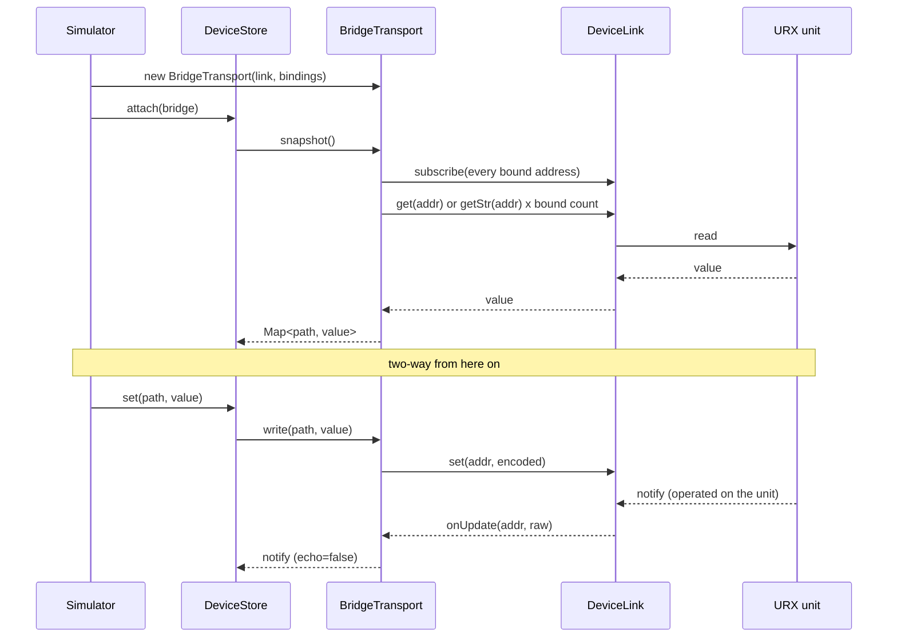

# Device integration

The design and the steps for connecting the simulator's screens to the state of a real, connected URX.

## One connection point

The screen, widget and panel layers talk only to `DeviceStore`, and `DeviceStore` talks only to
`DeviceTransport` (`src/device/transport.ts`). Connecting a unit amounts to swapping the
implementation of this one interface.

| Implementation | Where the values live |
| --- | --- |
| `SimTransport` | A `Map` in this process (default) |
| `BridgeTransport` | The connected URX unit |

`BridgeTransport` has no protocol of its own. It is used with an injected `DeviceLink` (two reads, two
writes, one subscribe). Everything that talks to the unit is on the far side of this interface; the
simulator side handles only address strings and values that are integers or strings. A string
parameter (a channel name, a scene title) is read and written with `getStr` / `setStr`.

```ts
export interface DeviceLink {
  get(addr: string): Promise<number>;
  set(addr: string, value: number): Promise<void>;
  getStr(addr: string): Promise<string>;
  setStr(addr: string, value: string): Promise<void>;
  subscribe(addrs: string[], onUpdate: (addr: string, raw: number) => void): Promise<() => void>;
}
```

## The unit behind the screens

The values are one of four things the unit does by itself. `Unit` (`src/device/unit.ts`) carries all of
them, and the screens ask it without knowing which kind of unit answers.

| Part | What it is | Simulated unit |
| --- | --- | --- |
| `params` | The `DeviceTransport` the store attaches to | `SimTransport` |
| `levels` | What the meters read: `simulated`, or `device` with a reader of levels in dB and a Clip Safe state per connector | The synthetic signal (`src/screens/signal-flow.ts`) |
| `actions` | Who carries out the operations on the unit's own memory, card and recorder: `simulated`, or `device` with a `perform(op)` that answers whether the unit took the operation | Each carried out on the simulated memory (`emulatedActions`) |
| `clock` | The moment the unit's clock runs off, before the DATE / TIME dialog moves it | The computer's clock |

An operation (`UnitOp`) carries everything the unit needs to carry it out, and nothing of the screens or of
the simulator:

| Operation | Arguments |
| --- | --- |
| `scene.recall` | `scene`: the number, 0 and the presets being the factory scenes |
| `scene.store` | `bank`, `scene`, and the `title` typed for it |
| `scene.protect` | `bank`, `scene`, and `protect`: whether it is protected after |
| `scene.delete` | `bank`, `scene` |
| `settings.save` | `file`: the folder and the name, written over a settings file of that name there or as a new one |
| `settings.load` | `file` |
| `card.insert`, `card.eject`, `card.test` | none |
| `card.format` | `label`: the volume label typed, empty for none |
| `card.delete` | `file` |
| `card.rename` | `file`, and the name `to` |
| `card.newFolder` | `file`: the folder it is made in and its name |
| `recorder.arm`, `recorder.record`, `recorder.pause`, `recorder.stop` | none |
| `playback.start` | `file`: the file to play, or the one paused to go on with |
| `playback.pause`, `playback.stop` | none |

A screen hands an operation over as soon as it is asked for and confirmed, and whether the unit can carry
it out is the unit's to answer: the simulated unit leaves undone an entry its card does not carry, a
settings file holding nothing, and a file or a take its card has no room for. A `device` unit is handed
the operation and nothing of the simulator's own memory, card or recorder moves — `refusedActions` is one
that refuses each one and reports it. The simulated recorder also stops a take at the room its card has
and a file at its end, on the counters' clock; a `device` unit's recorder and playback move only as its
values report them, and the counters write nothing. The edits a screen makes to values stay `params`'
business, as they are on every kind of unit.

`useUnit()` (`src/app/unit.ts`) hands a unit's levels and clock to the meters and the clock; one unit is
mounted on a page at a time. A unit's levels reach the meters through `setMeterSource()` and
`setClipSafeSource()` (`src/screens/meters.ts`), whose ids are described under "Wiring it up" below.

## Embedding the glass in another page

`mountSim()` (`src/embed.ts`, exported as `urx-lcd-sim/embed`) mounts the glass of a model in an element
of another page, reading and writing through the `Unit` it is handed. It mounts the 480x272 glass alone:
no unit model or display scale selector, no Device menu, no link indicator, and nothing stored in the
browser. What it returns sets the display scale and lets the glass go, closing the unit's transport.

- The glass is drawn in the shadow tree of one element of the page (`.urx-lcd-sim`), so the page's rules
  do not reach the elements inside it and the glass's rules do not reach the page's (`src/embed-css.ts`).
  Inside the tree, `:root` reads as the glass's own root (`.embed-glass`), which starts from the initial
  value of every property rather than from what the page passes in. `@font-face` and `@property`, which a
  shadow tree does not take, stand on the page, and a font file loads from the URL the page passes in for
  it (`fonts`, by the file name under `public/fonts/`, which the package exports as
  `urx-lcd-sim/fonts/*`).
- The focus, a key and a pointer are read in the glass's own tree (`src/ui/active.ts`): seen from the
  page, the focus inside the glass and an event from inside it stand on the host element.
- A key pressed with nothing focused is the page's: Escape steps the glass back only while the focus is
  on the glass, and Tab is kept inside a dialog of the glass only while the focus is on the glass.
- A value drag marks the glass's root rather than the page.
- `shippedValues(model)` lists every path the glass reads and writes, with the value it ships with, for a
  host deciding which of them it answers.
- `setup.integration.daw` is not among them: a host that reads from the unit whether a compatible DAW
  holds it answers it (a boolean), and SETUP's [Software Integration] then follows it as the unit's entry
  does — out of reach with none, opening with one. Left unanswered, the entry opens as it does on the
  simulator's own page ([known-issues.md](known-issues.md)). A settings file does not carry it.

### Controls the page holds shut

A page can hold controls of the glass shut and say why: `locks` in the options `mountSim()` takes, and
`setLocks()` on what it returns, which replaces the whole set and draws the glass again (`src/ui/locks.ts`).
Each lock (`SimLock`) is a target and the reason the page gives for it. A target (`LockTarget`) is one of:

| Target | Holds shut |
| --- | --- |
| `{ kind: "path", path }` | a control that writes that path: a value box, a knob, a fader, a switch, a pulldown, a button that opens the sheet picking it. A control that writes several paths is held by its first. |
| `{ kind: "screen", id }` | a button that opens the screen of that route id: HOME's `setup` / `microsd` / `monitor`, SETUP's entries (`setup.language`, `setup.rate`, ...), microSD's (`microsd.saveload`, ...), a channel's blocks (`ch.eq`, ...). |
| `{ kind: "op", op }` | a button that hands the unit that operation (`UnitOp["kind"]`: `scene.recall`, `recorder.arm`, `card.eject`, ...). A transport button that hands the unit a different operation in each state is held by the one it would hand it now. |

- A control held shut takes the face of a control out of reach (`is-disabled`, `aria-disabled="true"`) and
  `is-held-shut`, carries a padlock at its top right corner (`aria-hidden="true"`), and gives the page's
  reason as its `title` and its `aria-description`. Its name is left as it was. Letting it go gives back
  what the control carried before, so a control the screen itself holds out of reach stays out of reach.
- It answers no touch, Enter or Space, and a value held shut turns by no drag, wheel or key.
- Behind the drawing, the glass refuses what a held control would do however it is reached:
  `DeviceStore.setLocked()` refuses an edit of a held path whole, and one that carries a write onto one
  (a linked pair's other channel, say), reporting nothing to `onWriteFailure`; the navigator opens no held
  screen (`Navigator.setRefusal()`, the back arrow and the home button aside); `perform()` hands the unit
  no held operation. A value the unit changes itself still reaches the glass.
- A control names its target where it is built (`lockable`, `writes`, `writing` and `aimed` in
  `src/ui/dom.ts`): the numeric controls built from a `NumericSpec` name its path themselves, a
  pulldown names the `path` it is given, and a dialog's [OK] (`dialog` and `pickDialog` in
  `src/ui/widgets.ts`) names what its `onOk` was named with, and the title entry's [OK] names the path it
  writes what is typed to, so a dialog or a sheet already open when the page holds that target has its [OK]
  drawn shut. A control that names none is drawn as it is, while the refusals
  above still hold for it.
- The simulator's own page holds nothing, and a page that passes no locks sees the glass as before.

### An insert effect's values from the page

Choosing an insert effect fills its values with the effect's own settings, as the unit does. A page that
keeps those values itself — one that brings back what a node held the last time it carried that effect —
passes `insertValuesFromPage: true` to `mountSim()`: choosing an effect then writes the effect and its
switch alone, and the glass shows the values the unit answers with. The FX channels' effects are filled
either way.

## Binding table

`BindingTable` (`src/device/binding.ts`) holds the mapping from path to address + encoding.
**It starts empty**, and filling it is the responsibility of whoever supplies a validated catalog.
Calling `BridgeTransport.write()` while it is empty throws `UnboundPathError`. There is no path by
which a guessed address is written to the unit.
A value whose encoding is not a finite number (an enumeration's tag given to `identityCodec`, say) is
refused as well, without being sent to the unit.

A catalog may carry only addresses and encodings confirmed against the unit one parameter at a time.
This repository ships no catalog.

## Two-way

`BridgeTransport.snapshot()` subscribes to every bound address. Changes made on the unit's LCD or
physical knobs arrive as notifies and are reflected on the simulator's screen. It is a mirror, not a
one-way remote control. It subscribes before it reads, so `DeviceStore` also takes a change made on
the unit while the values are read, after the values themselves. A string address (a channel name,
say) is read again with `getStr` on each of its notifies, and the string read is what arrives. A channel
renamed on the unit's (URX44V) LCD sends one notify for its address carrying the new name, and a read right after
it gives the new name too (2026-10-08).

Writes to one address go to `DeviceLink` one at a time, each once the link has answered the one
before it, so they reach the unit, and come back, in the order they were issued. A write the link
never answers holds up every later write to its address. A read a string address's notify starts
goes out once the writes to the address issued before it are answered, and no write waits for it:
a write to a string address drops a read of it not yet answered, and reads the address again when
the unit refuses the write.

A notify that is our own written value coming back is marked `echo: true`
("flags the notify that is our own write coming back" in `src/device/bridge-transport.test.ts`).

## Wiring it up



1. Implement `DeviceLink`. The host application owns the means of talking to the unit and hands only
   these five verbs to the simulator.
2. Fill `BindingTable` from a validated catalog.
3. Pass `new BridgeTransport(link, bindings)` to `store.attach()`.
4. To drive the meters from the unit, hand a `Unit` whose `levels` are `device` to `useUnit()` — or
   pass the unit's meter stream to `setMeterSource()` (`src/screens/meters.ts`) directly. The function passed is given a strip's id and the point on the strip it
   reads, joined by `@` (`ch3@preFader`, `bus.mix1@post`, and so on; the points are `Tap` in
   `src/screens/signal-flow.ts`), and `monitor.<n>`, `cue`, `osc` and `playback` (what the card's
   playback puts out, after microSD Playback's D.Gain). It is also given a strip's id alone, with no `@`
   (`bus.stereo`, `ch1`, and so on): that is what the strip puts out, and it is answered with the same
   value as `<strip>@post`. It returns levels in dB; a value that is not a number reads as silence, and one
   over 0 dB, +Infinity included, as a clip (over full scale; 0 dB itself is not one). Until one is passed, the simulator's internal
   synthetic signal is shown.

The `chrome-link` indicator at the top of the screen (`src/ui/link-indicator.ts`) reads `store.kind`
again on every change to the store, so the connection state shows as it is, also when the
`BridgeTransport` is passed to `store.attach()` after the simulator has started.

While the store is on a unit (`store.kind` is `bridge`), nothing the browser kept ("What survives a
reload" in [architecture.md](architecture.md)) is written to the unit. `restore()` does nothing, and
`startSaving()` writes the mirror to `localStorage` under `urx-lcd-sim.bridge.state` rather than to the
IndexedDB record that holds the simulator. The simulated unit stored there, its scenes, card and settings
files included, stays as it was stored.

## With only some paths bound

`store.attach()` replaces the mirror with the values `BridgeTransport.snapshot()` reads, so once attached
the mirror holds the bound paths alone, but for the values the screens keep for themselves with no address,
which stay as they were (below). An unbound path holds no value, and a read of it returns the
caller's fallback. An edit to it is refused by `BridgeTransport` with `UnboundPathError`, and
`DeviceStore` puts the mirror back and reports the refusal through `onWriteFailure` ("mirrors the bound
paths alone, puts an edit to an unbound path back and writes a bound one" in
`src/device/bridge-transport.test.ts`). An edit goes to the unit together with the writes the write rule
adds to it ("The writes one edit carries with it" in [architecture.md](architecture.md)), and an operation a
screen makes of one setting and the values that follow from it goes as one (`DeviceStore.operation()`): BUS
Type, Signal Type, PAN/BAL, COMP / EQ, 1-knob EQ, an effect, an input source, the sampling frequency, Pitch
Fix's keys and scale, cueing a strip of the other CUE group or taking the last input cue out, SCENE's bank,
storing a scene with its title, the recorder, playback and the card. Where
`BridgeTransport.writable()` says one of their paths has no address, none of them is sent, the mirror goes
back to what it held before, and the refusal of each such path is reported. Switching on an unbound HI-Z
sends no A.Gain, and taking an unbound BUS Type or Signal Type sends none of the sends, pans or other values
it brings with it ("sends none of the writes the Shell's rule carries with an edit to an unbound path" in
the same file, and `src/screens/operations.test.ts`). A path with no address among those an operation writes
keeps the whole operation back, also where the unit already holds the value it would write. A value the
screens keep for their own showing holds nothing back (`src/screens/screen-only.ts`: anything under `ui.`,
and the recorder's and playback's counters with the moments they count from):
it goes with the rest, and where it has no address it stays on the screen and is not sent, an edit to it
alone as well, so the recorder's and playback's counters run on a unit with their state bound and their
clocks not, and a take paused before the attach counts on from where it stood. An operation
that sets several values each on its own (a scene recall, a settings file Load, clearing every CUE, the
oscillator's Clear All, the output patch's Default, All Input and All USB DAW) sends each value as an edit of
its own.
