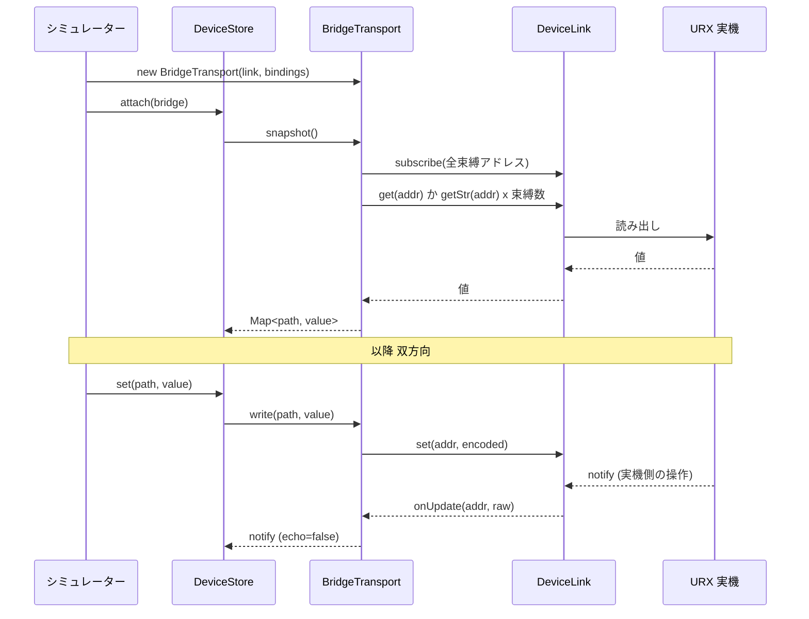

# 実機連携

シミュレーターの画面を、実際に接続した URX の状態に接続するための設計と手順。

## 接続点は 1 箇所だけ

画面層・ウィジェット層・パネル層は `DeviceStore` としか話さず、`DeviceStore` は
`DeviceTransport` (`src/device/transport.ts`) としか話さない。実機接続とは、この 1 つの
インターフェースの実装を差し替えることに等しい。

| 実装 | 値の所在 |
| --- | --- |
| `SimTransport` | このプロセスの `Map` (既定) |
| `BridgeTransport` | 接続された URX 実機 |

`BridgeTransport` は自前のプロトコルを持たない。`DeviceLink` (読み 2 種・書き 2 種・購読 1 種) を
注入して使う。実機と通信する部分はすべてこのインターフェースの向こう側にあり、シミュレーター側は
アドレス文字列と、整数か文字列の値しか扱わない。名前・題などの文字列のパラメータは `getStr` / `setStr` で
読み書きする。

```ts
export interface DeviceLink {
  get(addr: string): Promise<number>;
  set(addr: string, value: number): Promise<void>;
  getStr(addr: string): Promise<string>;
  setStr(addr: string, value: string): Promise<void>;
  subscribe(addrs: string[], onUpdate: (addr: string, raw: number) => void): Promise<() => void>;
}
```

## 画面の裏にある本体

値は、本体が自分で行うことの 1 つにすぎない。`Unit` (`src/device/unit.ts`) はその 4 つを持ち、画面は
どの種類の本体が答えるかを知らずにこれに尋ねる。

| 部分 | 中身 | シミュレーターの本体 |
| --- | --- | --- |
| `params` | store がつなぐ `DeviceTransport` | `SimTransport` |
| `levels` | メーターが読むもの。`simulated`、または dB のレベルを返す読み手と端子ごとの Clip Safe の状態を持つ `device` | 合成信号 (`src/screens/signal-flow.ts`) |
| `actions` | 本体が自分のメモリー・カード・レコーダーに対して行う操作を、誰が行うか。`simulated`、または操作を受け取ったかを答える `perform(op)` を持つ `device` | すべてシミュレーターのメモリーで行う (`emulatedActions`) |
| `clock` | DATE / TIME で動かす前の、本体の時計が刻む時刻 | コンピューターの時計 |

操作 (`UnitOp`) は、本体がそれを行うのに要るものをすべて持ち、画面のものもシミュレーターのものも持たない。

| 操作 | 引数 |
| --- | --- |
| `scene.recall` | `scene`: 番号。0 とプリセットは工場出荷のシーン |
| `scene.store` | `bank`・`scene`、入力した題名 `title` |
| `scene.protect` | `bank`・`scene`、保護するかどうか `protect` |
| `scene.delete` | `bank`・`scene` |
| `settings.save` | `file`: フォルダーと名前。そこにある同じ名前の設定ファイルに上書きし、無ければ新しく書く |
| `settings.load` | `file` |
| `card.insert`・`card.eject`・`card.test` | なし |
| `card.format` | `label`: 入力したボリュームラベル。無ければ空 |
| `card.delete` | `file` |
| `card.rename` | `file`、新しい名前 `to` |
| `card.newFolder` | `file`: 作る先のフォルダーと名前 |
| `recorder.arm`・`recorder.record`・`recorder.pause`・`recorder.stop` | なし |
| `playback.start` | `file`: 再生するファイル、または一時停止から続けるファイル |
| `playback.pause`・`playback.stop` | なし |

画面は操作を求められて確定した時点で渡し、それを行えるかは本体が答える。シミュレーターの本体は、カードに無い
項目・中身の無い設定ファイル・カードに入りきらないファイルや録音は行わない。`device` の本体には操作が渡され、
シミュレーターのメモリー・カード・レコーダーは何も動かない (`refusedActions` は、すべてを断り、断るたびに知らせる
本体)。シミュレーターのレコーダーは、カウンターの時計に合わせて、カードの空きで録音を止め、ファイルの終わりで
再生を止める。`device` の本体のレコーダーと再生は、その値が知らせるとおりにだけ動き、カウンターは何も書かない。
画面が値を編集するのは、どの種類の本体でも `params` の役目のまま。

`useUnit()` (`src/app/unit.ts`) は本体のメーターと時計を、メーターと時計に渡す。1 つのページにつなぐ本体は
同時に 1 つだけ。本体のメーターは `setMeterSource()` と `setClipSafeSource()` (`src/screens/meters.ts`) を通して
メーターに届き、その id は下の「組み込み手順」に書く。

## 別のページへの埋め込み

`mountSim()` (`src/embed.ts`。`urx-lcd-sim/embed` として公開) は、ある機種の画面を別のページの要素の中に置き、
渡された `Unit` を通して値を読み書きする。置くのは 480x272 の画面だけで、機種と表示倍率のセレクタ・Device メニュー・
接続表示は置かず、ブラウザに何も保存しない。戻り値で表示倍率を変え、画面を外す (本体の transport も閉じる)。

- 画面はページの 1 つの要素 (`.urx-lcd-sim`) の shadow tree の中に描くので、ページの規則は中の要素に届かず、
  画面の規則もページの要素に届かない (`src/embed-css.ts`)。tree の中では `:root` は画面自身の起点
  (`.embed-glass`) を指し、その起点はページから受け継ぐ値ではなく、すべてのプロパティの初期値から始まる。shadow
  tree が受け付けない `@font-face` と `@property` はページに置き、フォントのファイルはページが渡す URL から読む
  (`fonts`。`public/fonts/` のファイル名で指定し、パッケージは `urx-lcd-sim/fonts/*` として公開する)。
- フォーカス・キー・ポインターは、画面自身の tree の中で読む (`src/ui/active.ts`)。ページから見ると、画面の中の
  フォーカスと画面の中から来たイベントは、shadow tree を持つ要素の上にあるように見える。
- 何にもフォーカスが無いときのキーはページのもの。Escape で画面が戻るのは、フォーカスが画面にあるときだけで、
  画面のダイアログの中で Tab が回るのも、フォーカスが画面にあるときだけ。
- 値のドラッグ中の印は、ページではなく画面の起点の要素に付く。
- `shippedValues(model)` は、画面が読み書きするすべてのパスを出荷時の値と並べて返す。本体の側がどのパスに
  答えるかを決めるためのもの。
- `setup.integration.daw` はその中に無い。対応する DAW が本体とつながっているかを本体から読むホストがこれに答える
  (真偽値) と、SETUP の [Software Integration] は本体と同じくそれに従う (つながっていなければ使えない面、つながって
  いれば開く)。答えないときは、シミュレーター自身のページと同じく開く ([known-issues.md](known-issues.md))。設定
  ファイルには入らない。

### ページが使えなくするコントロール

ページは、画面のコントロールを使えなくし、その理由を示せる。`mountSim()` のオプションの `locks` と、戻り値の
`setLocks()` で渡す。`setLocks()` は組全体を置き換えて画面を描き直す (`src/ui/locks.ts`)。1 つのロック
(`SimLock`) は、対象と、ページが示す理由の組。対象 (`LockTarget`) は次のどれか。

| 対象 | 使えなくなるもの |
| --- | --- |
| `{ kind: "path", path }` | そのパスに書くコントロール。値ボックス・ノブ・フェーダー・スイッチ・プルダウン・その値を選ぶシートを開くボタン。複数のパスに書くコントロールは、そのすべてを名乗り、ページがどれか 1 つでも使えなくすれば使えなくなる。 |
| `{ kind: "screen", id }` | その route id の画面を開くボタン。HOME の `setup` / `microsd` / `monitor`、SETUP の項目 (`setup.language`、`setup.rate` など)、microSD の項目 (`microsd.saveload` など)、チャンネルのブロック (`ch.eq` など)。 |
| `{ kind: "op", op }` | 本体にその操作を渡すボタン (`UnitOp["kind"]`。`scene.recall`、`recorder.arm`、`card.eject` など)。状態ごとに渡す操作が変わるトランスポートのボタンは、いま押したときに渡す操作で決まる。 |

- 使えなくしたコントロールは、使えないコントロールの見た目 (`is-disabled`、`aria-disabled="true"`) と
  `is-held-shut` を持ち、右上の角に錠前の印 (`aria-hidden="true"`) を付け、ページが示した理由を `title` と
  `aria-description` に持つ。名前は変えない。ロックを外すと、コントロールが前に持っていたものを戻すので、
  画面自身が使えなくしていたコントロールは使えないまま残る。
- タッチ・Enter・Space に答えず、使えなくした値はドラッグ・ホイール・キーで動かない。
- 見た目の裏でも、使えなくしたコントロールがすることを、どこから届いても拒否する。`DeviceStore.setLocked()` は、
  使えなくしたパスへの編集と、それへ書き込みを運ぶ編集 (ステレオペアのもう片方など) を丸ごと拒否し、
  `onWriteFailure` には何も知らせない。ナビゲーターは使えなくした画面を開かない (`Navigator.setRefusal()`。
  戻る矢印と HOME ボタンは除く)。`perform()` は使えなくした操作を本体に渡さない。本体が自分で変えた値は
  これまでどおり画面に届く。
- コントロールは、作るところで自分の対象を名乗る (`src/ui/dom.ts` の `lockable`・`writes`・`writing`・`aimed`)。
  押したときに書く値は、すべて名乗る。`NumericSpec` から作る数値のコントロールはそのパスを自分で名乗り、
  プルダウンは渡された `path` を名乗る。押したときに書く値がストアの状態で変わるコントロール (反対の
  グループの CUE を外す [CUE]、1-knob のスイッチ、サンプリング周波数、チャンネルのペアを書き換える選択) は、
  画面を描くときに、その編集が書く値を名乗る (`DeviceStore.writesOf()`。編集をミラーに当てて、ミラーを
  元に戻し、何も書かない)。ストアがすでに持っている値も数える。使えなくしたパスは、それも拒否するため。
  一覧やシートの選択肢は、選んだときに書く値を名乗り、それを開く箱は自分が選ぶ値を名乗る。
  ダイアログの [OK] (`src/ui/widgets.ts` の `dialog`・`pickDialog`) は、`onOk` が名乗った対象を名乗る。
  名前入力シートの [OK] は、入力した文字を書くパスを名乗る。そのため、開いたままのダイアログやシートの
  対象をページが使えなくすると、その [OK] が使えない形で描かれる。
  何も名乗らないコントロールは見た目が変わらないが、上の拒否はそのコントロールにも効く。
- シミュレーター自身のページは何も使えなくせず、ロックを渡さないページでは画面はこれまでどおり。

### INS FX のエフェクトの値をページが決める

INS FX のエフェクトを選ぶと、本体と同じく、その値をエフェクト自身の設定で埋める。値をページの側で持つページ (前回そのエフェクト
だったときの値を戻すページなど) は、`mountSim()` に `insertValuesFromPage: true` を渡す。するとエフェクトを選んだときに書くのは
エフェクトとそのスイッチだけになり、画面は本体が答えた値を表示する。FX チャンネルのエフェクトはどちらでも埋める。

## 束縛テーブル

`BindingTable` (`src/device/binding.ts`) がパス → アドレス + 符号化の対応を持つ。
**初期状態は空**で、埋めるのは検証済みカタログを供給する側の責任になる。空のまま
`BridgeTransport.write()` を呼ぶと `UnboundPathError` を投げる。推測したアドレスを実機へ書く
経路は存在しない。
符号化した結果が有限の数にならない値 (列挙のタグを `identityCodec` に渡した場合など) も、実機へ
送らずに書き込みを拒否する。

カタログに載せてよいのは、実機に対して 1 パラメータずつ確認したアドレスと符号化だけ。
このリポジトリはカタログを同梱しない。

## 双方向であること

`BridgeTransport.snapshot()` は束縛済みの全アドレスを購読する。実機の LCD や物理ノブで行われた
変更が notify として届き、シミュレーター画面へ反映される。片方向のリモコンではなく、鏡になる。
購読は読み出しより先に張るので、読み出しの途中に実機で変わった値も、`DeviceStore` が読み出した値の後で採る。
文字列のアドレス (チャンネル名など) は、notify を受けるたびに `getStr` で読み直し、読めた文字列を届ける。
実機 (URX44V) の LCD でチャンネル名を変えると、そのアドレスに新しい名前を運ぶ notify が 1 本届き、その直後の読み直しも
新しい名前を返す (2026-10-08)。

1 つのアドレスへの書き込みは、`DeviceLink` が前の書き込みに応答してから次を送るので、出した順に
実機へ届き、出した順に返る。link が応答しない書き込みがあると、同じアドレスへのそれ以降の書き込みはすべて待ったままになる。
文字列のアドレスの notify で始める読み直しは、それより前に出したそのアドレスへの書き込みに応答があってから送り、
書き込みは読み直しを待たない。文字列のアドレスへの書き込みは、そのアドレスのまだ応答の無い読み直しを捨て、
実機が書き込みを拒否したときは読み直す。

自分が書いた値がそのまま返ってきた notify は `echo: true` として区別する
(`src/device/bridge-transport.test.ts` の「flags the notify that is our own write coming back」)。

## 組み込み手順



1. `DeviceLink` を実装する。実機との通信手段はホストアプリケーション側が持ち、この 5 つの動詞
   だけをシミュレーターへ渡す。
2. `BindingTable` を検証済みカタログから埋める。
3. `new BridgeTransport(link, bindings)` を `store.attach()` に渡す。
4. メーターを実機の値にする場合は、`levels` が `device` の `Unit` を `useUnit()` に渡すか、`setMeterSource()`
   (`src/screens/meters.ts`) に実機のメーターストリームを直接渡す。渡した関数は、ストリップの id とそのストリップ上の読む点を `@` でつないだ id
   (`ch3@preFader`・`bus.mix1@post` など、読む点は `src/screens/signal-flow.ts` の `Tap`) と、`monitor.<n>`・`cue`・`osc`・
   `playback` (カードの再生が出すもの。microSD Playback の D.Gain の後) を受け取る。`@` の無いストリップの id (`bus.stereo`・`ch1` など) も
   受け取り、これはそのストリップの出力で、`<strip>@post` と同じ値を返す。レベルは dB で返し、数でない値は無音、0 dB を超える値は
   +Infinity も含めてクリップ (フルスケールを超えた値。0 dB ちょうどはクリップではない) として読む。渡さない間はシミュレーター内部の合成信号が表示される。

画面上部の `chrome-link` 表示 (`src/ui/link-indicator.ts`) は store が変わるたびに `store.kind` を読み直すので、
起動した後で `BridgeTransport` を `store.attach()` に渡しても、接続状態がそのまま出る。

実機につないでいる間 (`store.kind` が `bridge`) は、ブラウザに残した値 ([architecture.md](architecture.md)「残る値」) を
実機へ書かない。`restore()` は何もせず、`startSaving()` はミラーを、シミュレーターを持つ IndexedDB の記録ではなく
`localStorage` の `urx-lcd-sim.bridge.state` に書く。シミュレーターの本体 (シーン・カード・設定ファイルを含む) は保存したまま残る。

## 束縛が一部だけのとき

`store.attach()` はミラーを `BridgeTransport.snapshot()` が読んだ値で置き換えるので、接続した後のミラーには
束縛したパスだけが載る。ただし、画面が自分のために持つ値のうちアドレスの無いものは、接続の前のまま残る (後述)。束縛していないパスは値を持たず、読むと呼び出し側の既定値が返る。その編集は
`BridgeTransport` が `UnboundPathError` で拒否し、`DeviceStore` はミラーを元に戻して `onWriteFailure` で知らせる
(`src/device/bridge-transport.test.ts` の「mirrors the bound paths alone, puts an edit to an unbound path back and
writes a bound one」)。編集は、書き込み規則が連れていく書き込み ([architecture.md](architecture.md) の「1 つの編集が
連れていく書き込み」) と一緒に実機へ送られ、画面が 1 つの設定とそれに従う値をまとめて書く操作は 1 つとして送られる
(`DeviceStore.operation()`)。BUS Type、Signal Type、PAN/BAL、COMP / EQ、1-knob EQ、エフェクト、入力ソース、サンプリング
周波数、Pitch Fix の鍵盤とスケール、もう一方のグループのストリップの CUE と最後の入力の CUE を外すこと、SCENE のバンク、題を付けたシーンの保存、レコーダー、再生、カードの操作がこれに当たる。
そのどれかの経路にアドレスが無いと `BridgeTransport.writable()` が答えると、どれも送らず、ミラーを前の値に戻し、その経路ごとの
拒否を知らせる。束縛していない HI-Z を入れても A.Gain は送られず、束縛していない BUS Type や Signal Type を選んでも、それが
連れていく送り・定位などの値は何も送られない (同じファイルの「sends none of the writes the Shell's rule carries with an edit
to an unbound path」と `src/screens/operations.test.ts`)。操作が書く経路の中にアドレスの無いものが 1 つあれば、実機がすでに
その値を持っている場合でも操作全体を送らない。画面が自分の表示のために持つ値 (`src/screens/screen-only.ts`: `ui.` の下の値と、
レコーダーと再生のカウンター、およびその起点の時刻) は操作を止めない。ほかの値と一緒に送り、アドレスが
無ければ、その値だけを書く編集でも送らずに画面に残す。レコーダーと再生の状態だけを束縛した実機でも、カウンターは進み、接続の前に一時停止したテイクはそこから数え続ける。複数の値をそれぞれ単独で書く操作 (シーンのリコール、設定ファイルの Load、
CUE の一括解除、オシレーターの Clear All、出力パッチの Default、All Input と All USB DAW) は、値ごとに 1 つの編集として送る。
